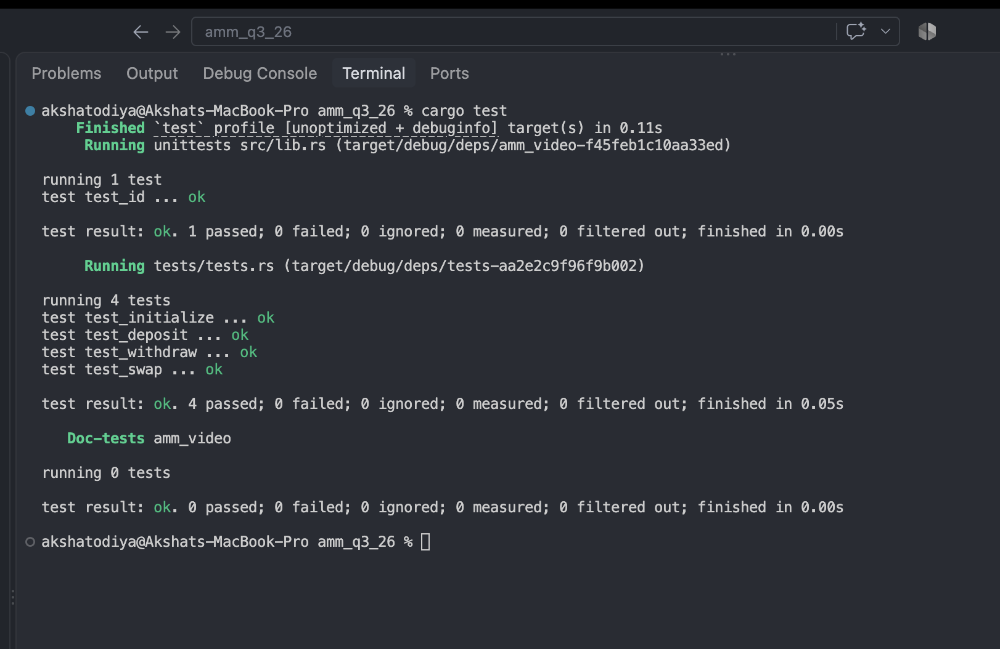

# AMM Q3 26

A tiny Solana AMM built with Anchor, aimed at keeping things simple and correct. It supports pool setup, liquidity deposits, withdrawals, token swaps, and a basic fee flow that sends collected fees to a treasury account.

## What this project includes

- `initialize` instruction to set up the AMM config and vaults
- `deposit` instruction for adding liquidity
- `withdraw` instruction for removing liquidity
- `swap` instruction for token swaps with fees
- `lock` / `unlock` instructions so the config authority can pause the pool
- treasury account support so fees are routed out of the pool; `swap` checks the treasury against the config, so a swapper cannot route the fee to an account of their own
- `initialize` rejects fees above 100% (10,000 bps)
- test coverage for all instructions, including the failure cases (foreign treasury, locked pool, non-authority lock, fee above 100%)

## Quick start

```bash
cargo build-sbf --manifest-path programs/amm-video/Cargo.toml
cargo test
```

## Project layout

- `programs/amm-video/src` — on-chain Rust program
- `programs/amm-video/tests` — integration-style instruction tests
- `runbooks/` — deployment and signer notes

## Notes

This was kept intentionally minimal, but the core AMM flow is there and working. The fee logic follows the same general idea as a simple Uniswap-style constant product pool, without overcomplicating the code.

## Screenshot


