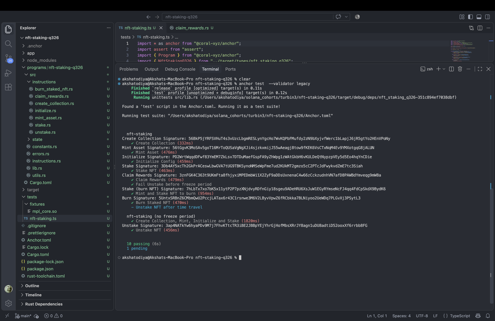

# NFT Staking (Turbin3 Q3 2026)

An Anchor program for staking Metaplex Core NFTs. Holders stake an NFT from a collection, earn reward tokens over time, claim them without unstaking, and can burn a staked NFT for a one-time bonus. Staking stats are tracked on the collection itself through the Attributes plugin.

- **Framework:** Anchor 1.2.0
- **NFT standard:** Metaplex Core (`mpl-core` 0.12.1)
- **Solana toolchain:** Agave 4.1.2 (pinned in `Anchor.toml`)
- **Program ID:** `F2EenmddwQTMzbpAiqkCvwfkpcSvHi8e5F9286CcuzMo`

## Instructions

| Instruction | What it does |
|---|---|
| `create_collection` | Creates a Core collection with a program PDA as the update authority |
| `initialize` | Creates the config (`rewards_bps`, `freeze_period`, `admin`) and the rewards mint. The collection keypair must sign, so nobody else can set the reward terms first |
| `mint_asset` | Mints a Core asset into that collection. Admin only, otherwise anyone could mint NFTs and farm rewards |
| `stake` | Tags the asset as staked, freezes it, `total_staked += 1` on the collection |
| `claim_rewards` | Mints accrued rewards, NFT stays staked and frozen |
| `unstake` | After the freeze period, pays the remaining rewards, unfreezes, `total_staked -= 1` |
| `burn_staked_nft` | After the freeze period, burns a staked NFT via BurnDelegate, pays a bonus plus pending rewards, `total_staked -= 1` |

## Running it

```bash
npm install
anchor test --validator legacy
```

---

## Ab formal khatam, asli baat shuru 🍿

### Ye hai kya bhai?

Simple hai. Tera NFT wallet mein pada pada dhool kha raha tha. Ab tu use stake kar, program use **freeze** kar deta hai (bechne ka koi scene nahi, "sirf ek baar dekh raha tha" wala bahana nahi chalega), aur har din tujhe reward tokens milte hain. Basically **FD, but for JPEGs.** Papa ko bolna "investment kiya hai". 📈

### Features, aur har feature ki kahani

**1. `claim_rewards`: "Beta, byaaj nikaal le, FD mat tod" 🏦**

Pehle reward chahiye tha to unstake karna padta tha. Matlab chai peeni hai to poora dhaba band karo. Ab nahi.

- Last claim ke baad jitne **poore din** hue, utne din ka reward seedha tere ATA mein.
- NFT **staked bhi rehta hai aur frozen bhi**. Claim sirf Attributes plugin chhoota hai, FreezeDelegate ko haath bhi nahi lagata.
- Asset pe ek `last_claimed_at` attribute save hota hai, aur wo sirf poore din jitna aage badhta hai. Adha din bacha hai to wo agle claim mein gina jaayega, kuch waste nahi hota. Sharma ji ka beta bhi itna hisaab nahi rakhta.
- Unstake bhi `last_claimed_at` se hi reward deta hai, to ek hi din ke do baar paise nahi milenge. **Double dipping? Na na, ye Sarojini Nagar nahi hai.** 🙅

**2. `burn_staked_nft`: "Sab kuch jala dunga" arc 🔥**

Kabhi kabhi insaan bolta hai "bas, ab aur nahi". Ab tu apna staked NFT **permanently burn** kar sakta hai, aur badle mein milta hai **1,000 tokens ka one-time bonus** (`BURN_BONUS_TOKENS` in `constants.rs`), aur jo reward pending tha wo bhi saath mein. Pending reward chhod ke jaana? Hum Indians hain, **100 rupaye ka recharge bhi waste nahi karte.**

Andar kya hota hai, ek ek step:
1. Pehle NFT **unfreeze** hota hai, kyunki frozen cheez jalti nahi. Physics hai bhai.
2. Owner **BurnDelegate** plugin add karta hai, aur jalane ka adhikaar program ke PDA ko de deta hai.
3. PDA burn delegate ban ke `BurnV1` chalata hai. 💀 RIP.
4. Collection pe `total_staked` ek kam.
5. Reward mint. Paisa hi paisa hoga. 🤑

**3. Collection-level `total_staked`: society ka WhatsApp group 📊**

Poori collection ka hisaab **collection account pe hi Attributes plugin mein** rehta hai, bilkul society ke group jaisa jahan sabko sabka pata hota hai.

- `stake` pe `+1`, `unstake` aur `burn_staked_nft` pe `-1`.
- Pehli baar kisi ne stake kiya to plugin khud ban jaata hai, uske baad sirf update hota hai.
- Sab `src/utils.rs` ke ek helper `update_total_staked` mein hai. Ek hi kaam teen jagah copy-paste? **Humse na ho paayega.**

### Tests 🧪

`tests/nft-staking.ts` mein har instruction ka test hai:

```
nft-staking
  ✔ Create Collection
  ✔ Fail Initialize without the collection keypair
  ✔ Initialize Config
  ✔ Mint Asset
  ✔ Fail Mint by a non-admin
  ✔ Stake NFT
  ✔ Claim Rewards
  ✔ Fail Unstake before freeze period
  ✔ Mint and Stake NFT to burn
  ✔ Fail Burn before freeze period
  - Unstake NFT after time travel

nft-staking (no freeze period)
  ✔ Create Collection, Mint, Initialize and Stake
  ✔ Unstake NFT
  ✔ Restake the unstaked NFT
  ✔ Mint, Stake and Burn NFT

14 passing, 1 pending
```

**"1 pending" dekh ke ghabra mat.** Wo test fail nahi hai, skip hua hai. Wo 3 din aage **time travel** karta hai, aur time travel sirf **Surfpool** mein hota hai. Legacy validator mein time travel nahi hota, wo "Tarak Mehta" ki tarah same time pe atka rehta hai. Isliye freeze period 0 wala ek alag collection banaya hai, jisme unstake bina time machine ke test ho jaata hai. **Jugaad is not a bug, it's a feature.** 🛠️



### Setup mein jo pareshaani aayi (taaki tujhe na aaye) 😤

- **"Program is not deployed"**: Anchor 1.2 program ko **SBPF v3** mein build karta hai, aur Solana 3.1.10 wala validator usse pehchanta hi nahi. Isliye `Anchor.toml` mein `solana_version = "4.1.2"` pin kiya hai. Heads up: anchor tera global Solana CLI bhi 4.1.2 pe switch kar deta hai. Purana chahiye to `agave-install init 3.1.10`.
- **MPL Core local validator pe hai hi nahi**: mainnet se dump karke `tests/fixtures/mpl_core.so` mein rakha, aur `[[test.genesis]]` se load hota hai. Ghar ka khana, bahar se mangwaya. 🍱
- **`mpl-core` ka `anchor` feature Anchor 0.31 ke liye bana hai**, 1.2 ke saath nahi chalta. Isliye asset aur collection `UncheckedAccount` hain, aur owner / update authority ke checks handler mein `from_bytes` se hote hain. Kaam wahi, rasta alag.

### Fixed: dobara stake 🔁

Pehle unstake ke baad **wahi NFT dobara stake** karne pe fail hota tha, kyunki stake FreezeDelegate plugin ko dobara *add* karta tha. Ab plugin pehle se laga ho to stake use *update* karke freeze karta hai. Test bhi hai: `Restake the unstaked NFT`.

---

*Bana Turbin3 ke liye, chai aur thodi si neend ke saath.* ☕
