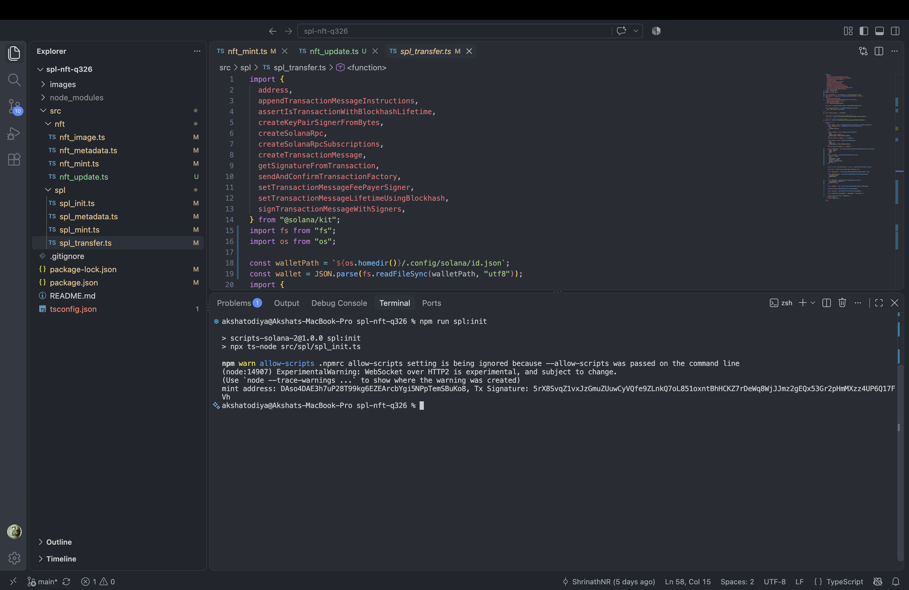
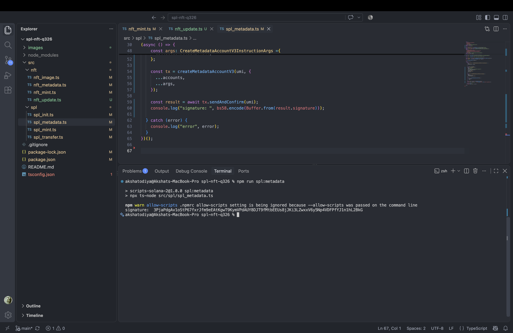
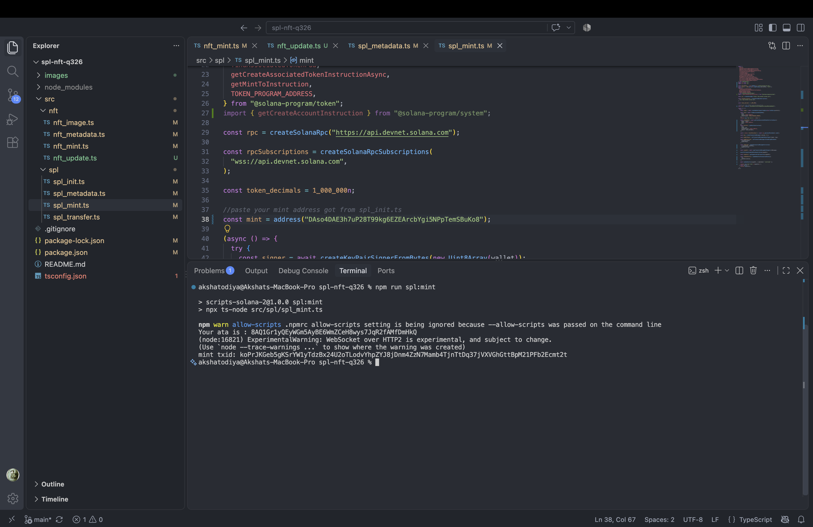
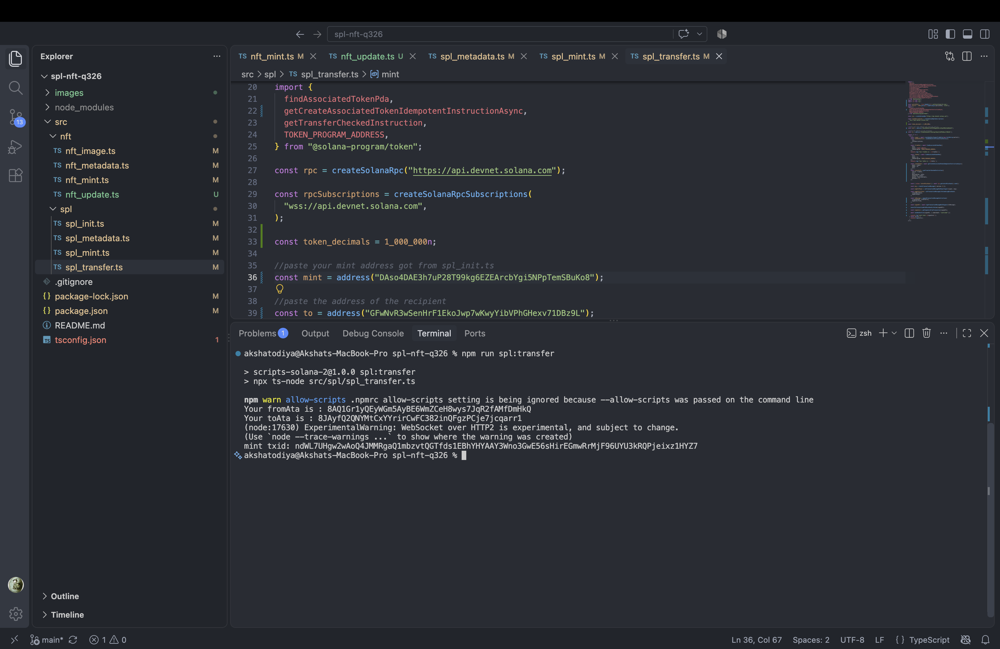
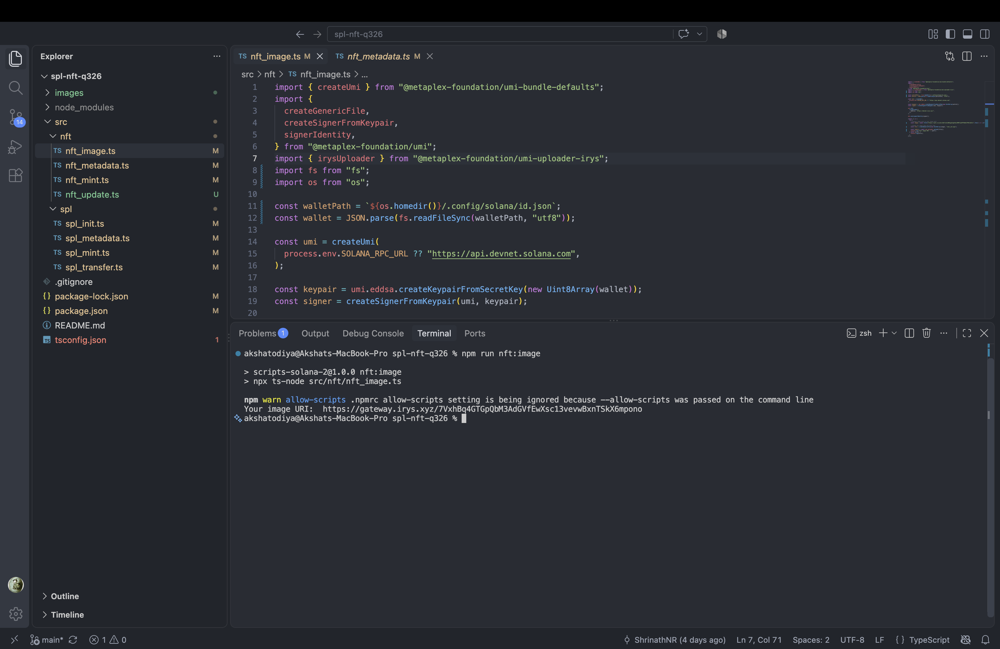
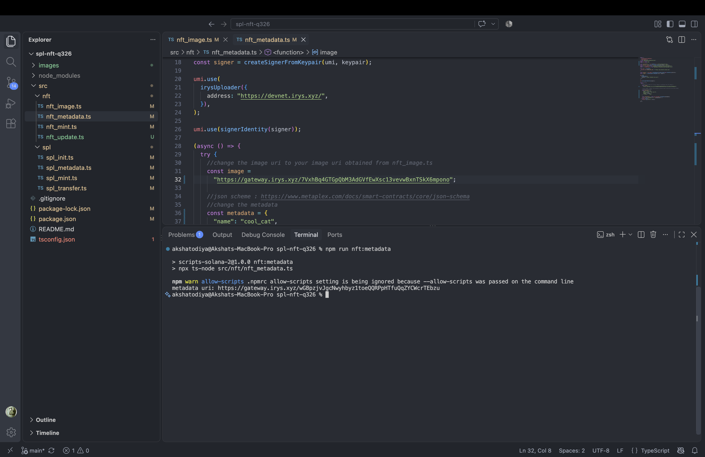
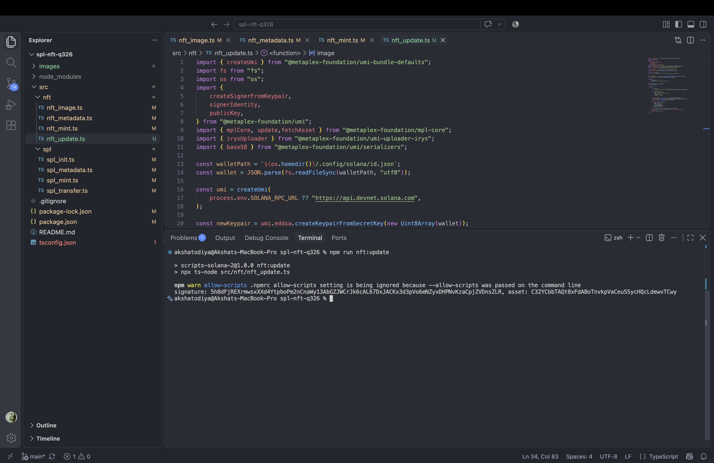

# spl-nft-q326

Seven small scripts that create an SPL token and an MPL Core NFT on Solana devnet, run one at a time from the terminal.

It covers three things:

| Task | Scripts |
|---|---|
| Mint and transfer my own SPL token | `spl_init` → `spl_metadata` → `spl_mint` → `spl_transfer` |
| Mint an NFT using MPL Core | `nft_image` → `nft_metadata` → `nft_mint` |
| Update the NFT's name and metadata as update authority | `nft_update` |

SPL side uses `@solana/kit` with `@solana-program/token`, plus `mpl-token-metadata` through UMI for the token's on-chain metadata. NFT side uses `mpl-core` through UMI, with the image and JSON stored on Irys.

## Setup

You need a devnet keypair at `~/.config/solana/id.json` with some SOL in it. Every script reads that path directly, so there is nothing to configure:

```bash
solana config set --url devnet
solana airdrop 2
npm install
```

If you want to point at a different RPC, the NFT scripts respect `SOLANA_RPC_URL`.

## Running

The scripts are meant to be run in order, and each one prints something the next one needs. There is no shared state file, so you paste the value from the terminal into the next script before running it.

```bash
npm run spl:init        # creates the mint, prints the mint address
npm run spl:metadata    # paste mint address, attaches name/symbol/uri
npm run spl:mint        # paste mint address, creates my ATA and mints 1 token
npm run spl:transfer    # paste mint address + recipient, sends the token

npm run nft:image       # uploads the image, prints the image URI
npm run nft:metadata    # paste image URI, uploads the JSON, prints the metadata URI
npm run nft:mint        # paste metadata URI, mints the asset, prints the asset address
npm run nft:update      # paste asset address, renames it and swaps the metadata
```

One thing worth knowing about `spl_transfer`: the `to` value has to be a **wallet address**, not a token account. The script derives the recipient's ATA from it and creates that account if it does not exist yet. If you paste an ATA in there, the tokens land in an account nobody can sign for and they are gone for good.

## What I deployed

Everything below is live on devnet.

**SPL token (`falcoin` / `FAL`, 6 decimals)**

| | |
|---|---|
| Mint | `DAso4DAE3h7uP28T99kg6EZEArcbYgi5NPpTemSBuKo8` |
| Create mint tx | `5rX8SvqZ1vxJzGmuZUuwCyVQfe9ZLnkQ7oL851oxntBhHCKZ7rDeWq8WjJJmz2gEQx53Gr2pHmMXzz4UP6Q17FVh` |
| Metadata tx | `3PjaPdgAv1oStP67fxrJfm9eEAtKgwT9KymVPdAUY8DJT9fMtbEEUs8jJKi3LZwxxV6y5Np4VDFPfYJ1n1hL2BkG` |
| My ATA | `8AQ1Gr1yQEyWGm5AyBE6WmZCeH8wys7JqR2fAMfDmHkQ` |
| Mint-to tx | `koPrJKGeb5gKSrYW1yTdzBx24U2oTLodvYhpZYJ8jDnm4ZzN7Mamb4TjnTtDq37jVXVGhGttBpM21PFb2Ecmt2t` |
| Recipient | `GFwNvR3wSenHrF1EkoJwp7wKwyYibVPhGHexv71DBz9L` |
| Recipient ATA | `8JAyfQ2QNYMtCxYYrirCwFC382inQFgzPCje7jcqarr1` |
| Transfer tx | `ndWL7UHgw2wAoQ4JMMRgaQ1mbzvtQGTfds1EBhYHYAAY3Wno3GwE56sHirEGmwRrMjF96UYU3kRQPjeixz1HYZ7` |

**NFT (MPL Core)**

| | |
|---|---|
| Asset | `C32YCbbTAQt8xFdABoTnvkpVaCeuSSycHQcLdewvTCwy` |
| Image | `https://gateway.irys.xyz/7VxhBq4GTGpQbM3AdGVfEwXsc13vevwBxnTSkX6mpono` |
| Metadata | `https://gateway.irys.xyz/wGBpzjvJgcNwyhbyz1toeQQRPpHTfuQqZYCWcrTEbzu` |
| Update tx | `5h8dFjREXrmwsxXXd4YtpboPm2nCnaWy13AbGZJWCrJk6cAL67DxJACKx3d3pVo6eNZyxDHPNvKzaCpjZVDnsZLR` |

The update went from `cool_cat` to `coolest_cat` with a fresh metadata JSON uploaded to Irys, signed by the same wallet that minted it, which is the update authority.

## Screenshots

Each run and its output.

### spl_init


### spl_metadata


### spl_mint


### spl_transfer


### nft_image


### nft_metadata


### nft_update


## Reference

- [Solana token docs](https://solana.com/docs/tokens)
- [Solana Kit](https://www.solanakit.com/)
- [Metaplex Token Metadata](https://www.metaplex.com/docs/smart-contracts/token-metadata)
- [Metaplex Core](https://www.metaplex.com/docs/smart-contracts/core)
