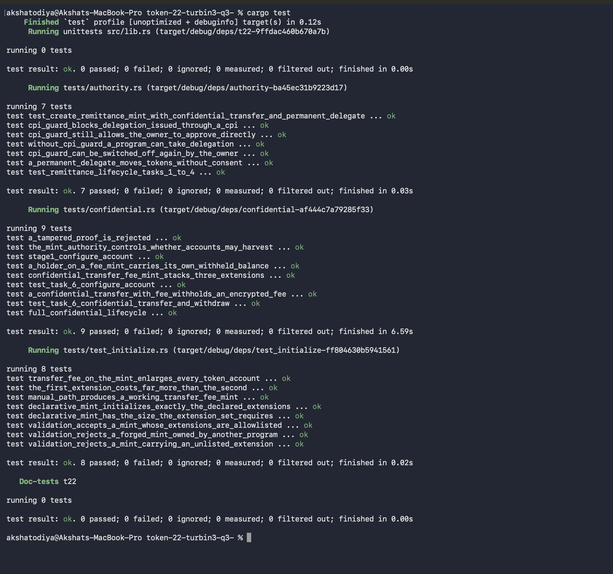

# Token-22 (t22): Turbin3 Q3

An Anchor program demonstrating the Token-2022 extension suite on Solana, covering transfer fees, permanent delegation, CPI guard, confidential transfers, and confidential transfer fees. The program lives in `programs/t22/src/lib.rs`, and the test suite in `programs/t22/tests/` exercises each extension end to end using `litesvm`.

No local validator required. The tests run in-process, which means you spend your time reading green checkmarks instead of watching a validator boot.

## Overview

Mints are set up two ways: declarative (the Anchor macro path, `#[account(init, extensions::...)]`) and manual (writing out the CPI chain by hand: `create_account`, then each extension's initializer, then `initialize_mint2`). Both give the same result. The macro is the "it just works" button; the manual path is for when you want to know *why* it works.

Extensions covered:

- **Transfer fee**: charging a fee on the mint, plus a safe transfer that goes through the fee path
- **Permanent delegate**: mint authority can move tokens without the holder's approval
- **CPI guard**: the account owner can block delegation issued through a CPI
- **Mint close authority + metadata pointer + default account state**: a remittance mint where new accounts are created frozen and must be explicitly unfrozen
- **Confidential transfer**: the full lifecycle, configuring an account (with an ElGamal pubkey validity proof), deposit, transfer (equality, ciphertext-validity, and range proofs), and withdraw
- **Confidential transfer fee**: the same thing but with the fee kept encrypted too, covering both the harvest-to-mint and withdraw-from-mint paths

The confidential instructions (`configure_account`, `confidential_transfer`, `withdraw_confidential`) take proofs as pre-verified context state accounts instead of instruction arguments, because `ProofLocation` is an enum that holds a reference, and Borsh can't deserialize a reference back out of instruction data. So the proof gets verified against the ZK ElGamal proof program and staged into a context account first, and the program is just handed that account's pubkey. Borrow checker: 1, me: 0, workaround: shipped.

## Getting Started

```bash
anchor build
cargo test
```

`cargo test` is the fastest option since it runs on `litesvm`. No `anchor test`, no local validator, no waiting around.

## Test Results

All 24 tests pass across three files: `authority.rs` (permanent delegate, CPI guard, remittance mint lifecycle), `confidential.rs` (confidential transfer and confidential transfer fee lifecycle), and `test_initialize.rs` (declarative vs manual mint creation).



All green. No flaky tests were harmed in the making of this screenshot.

## Repository Structure

```
programs/t22/
├── src/
│   └── lib.rs          # the whole program, all instructions and accounts
└── tests/
    ├── authority.rs     # permanent delegate, CPI guard, remittance mint lifecycle
    ├── confidential.rs  # confidential transfer and confidential transfer fee
    └── test_initialize.rs  # declarative vs manual mint creation
```

## Toolchain

- Anchor `1.2.0`, Solana `3.1.10` (pinned in `Anchor.toml`)
- Rust edition 2021, workspace MSRV `1.89.0`

If `anchor build` throws a rustc version mismatch, it's because Solana's platform-tools ship their own rustc, which reports a different version than the host machine's rustc. The workspace's `rust-version` needs to stay at or below that. Yes, Solana has two rustcs. No, nobody warns you.
