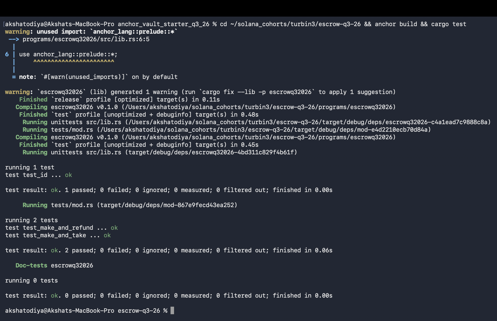

# Escrow (Q3 2026)

Two people swap SPL tokens without trusting each other. The maker locks token A in a vault
and says how much token B they want back. Any taker holding token B can complete the swap
in a single transaction. If nobody shows up, the maker takes their tokens back.

Nothing is held by a person in the middle — the vault is owned by a PDA, so either the swap
happens fully or it doesn't happen at all.

| PDA | Seeds | What it is |
|---|---|---|
| `escrow` | `["escrow", maker, seed]` | the deal: mints, amount wanted, expiry, bump |
| `vault` | ATA of `escrow` for `mint_a` | where the maker's tokens actually sit |

The `seed` is a `u64` the maker picks, so one maker can run many escrows at once.

## Instructions

- **make** — creates the escrow account, saves the terms, and moves the maker's token A into
  the vault.
- **take** — taker sends token B to the maker, vault sends token A to the taker, then the
  vault and the escrow account are both closed. All in one instruction, so it cannot half-finish.
  If the taker has no token A account or the maker has no token B account yet, take creates
  it (the taker pays the rent).
- **refund** — maker pulls their token A back out and closes everything.
- **update** — maker changes the terms of a deal that is still open. Only `receive` and
  `expiration`, and only in one direction each. More on that below, because this is the
  interesting one.

### Where the rent goes

This follows the diagrams in `arch/`:

- **take** — vault rent goes to the taker (they are the one closing it), escrow account rent
  goes back to the maker, because the maker is the one who paid for it in `make`.
- **refund** — everything goes back to the maker.

All the token transfers use `transfer_checked` through `TokenInterface`, so the program is
not tied to one token program. The tests run against SPL Token.

## About `update`

The escrow account has seven fields. Only two of them can be changed after `make`, and the
reason each of the other five is frozen is different.

| Field | Changeable | Why |
|---|---|---|
| `seed` | no | it is part of the PDA seeds |
| `maker` | no | PDA seed as well, and it is the authority — changing it hands the deal to someone else |
| `bump` | no | it is derived, not a setting |
| `mint_a` | no | the vault is already holding real `mint_a` tokens |
| `mint_b` | no | swapping it under a taker who is mid-transaction is pure griefing |
| `receive` | yes, downward only | the actual price |
| `expiration` | yes, outward only | the actual deadline |

`mint_a` is the one that would hurt the most. The vault is an ATA of the escrow for `mint_a`,
and the maker's tokens are already sitting in it. If the escrow could be pointed at a different
mint, the account would be claiming one thing while the vault held another. `take` would go
looking for a vault ATA of the new mint, find an empty account, and the tokens that were
actually deposited would be stuck there forever — `refund` would not help either, because it
checks `has_one = mint_a` and that check now points at the wrong mint. So the deposit is
unrecoverable. None of these five are even arguments to the instruction, so they cannot be
changed by accident.

### The front-running problem

`receive` is where it gets interesting. Look at what `take` does with it:

```rust
transfer_checked(cpi_context, self.escrow.receive, self.mint_b.decimals)?;
```

It reads the price straight off the account. The taker never passes an amount — there is
nothing for them to disagree with. So if the maker could raise `receive` freely:

1. taker sees an escrow asking for 7 token B, builds a `take`, signs it, sends it
2. maker sees that transaction in the mempool
3. maker lands an `update` in front of it setting `receive` to 700
4. taker's transaction executes and moves 700 token B out of their ATA

The taker signed for a deal they never agreed to. Their tokens are already in the ATA, the
program has authority to move them, and nothing in the instruction says otherwise.

Two things stop this here, and they are independent on purpose.

**`update` can only lower the price.** `receive` may go down, never up, and `expiration` may
only be pushed further out, never pulled in. A front-run can then only ever make the deal
better for the taker, so there is no reason to attempt one. This also has an honest use — a
maker whose escrow is not getting taken can drop the price without cancelling and re-making,
which would cost them two more transactions and a fresh rent deposit.

**`take` carries a `max_receive`.** The taker states the worst price they are willing to
accept, and the instruction fails if the escrow is asking for more. Same idea as slippage
protection on a swap. The rule above already prevents the attack, but the taker should not
have to depend on that rule still being there in the next version of the program.

One more thing `update` refuses to do: re-price an escrow that has already expired. A dead
deal is not a deal, so there is nothing to change.

### Expiration

`expiration` was being stored but nobody was reading it, so it was doing nothing. `take` now
checks it against the on-chain clock and fails with `EscrowExpired` if the deadline has passed.
Without that, updating the expiry would have been updating a field that had no effect.

Note that this only blocks new takes. It does not sweep anything — after expiry the maker
still has to call `refund` themselves to get their tokens out.

## Running it

```bash
anchor build
cargo test
```

Tests use **LiteSVM** with `litesvm-token`, so no validator and no devnet needed. `anchor build`
has to run first because the test loads the compiled `.so` from `target/deploy/`.

## Tests

**`test_make_and_refund`** — maker makes an escrow, then refunds it. Checks the vault actually
received the tokens, checks the terms saved on the escrow account, and checks both accounts
are gone after the refund.

**`test_make_and_take`** — a separate taker with their own keypair completes the swap. Checks
all four token accounts afterwards: maker paid out token A and received token B, taker did the
opposite, and both the escrow and the vault are closed.


