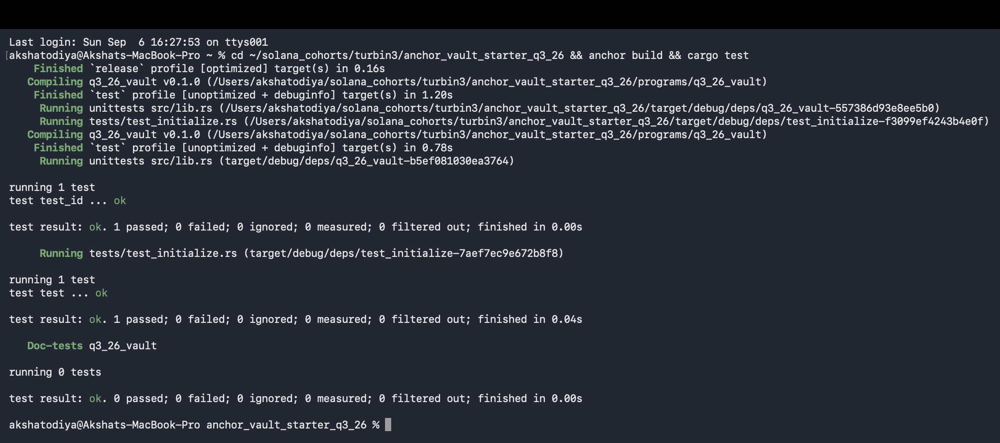

# Anchor Vault (Q3 2026)

A small Solana program where each user gets their own vault to keep SOL in. You put SOL
in, take some out whenever you want, and close the vault when you are done with it.

Everything is per-user. Two PDAs are derived from the user's own pubkey, so one user can
never touch another user's vault.

| PDA | Seeds | What it holds |
|---|---|---|
| `vault_state` | `["state", user]` | both bumps, so we don't re-derive them every time |
| `vault` | `["vault", user]` | the actual SOL (plain system account, no data) |

## Instructions

- **initialize** — creates `vault_state` and funds `vault` up to rent-exempt so it stays alive.
- **deposit** — moves SOL from the user into the vault. Rejects `0` with `InvalidAmount`.
- **withdraw** — moves SOL back to the user. The vault PDA signs for itself using the stored bump.
  It refuses to dip into the vault's rent reserve (`WithdrawBelowRentExempt`); `close` empties it.
- **close** — sends whatever is left in the vault back to the user and closes `vault_state`,
  so the user gets their rent back too.

`withdraw` and `close` sign the CPI with `["vault", user, vault_bump]`, since the vault is a
PDA and cannot sign on its own.

## Running it

```bash
anchor build
cargo test
```

Tests use **LiteSVM**, so no local validator is needed. The test loads the compiled `.so`
straight from `target/deploy/`, which is why `anchor build` has to run first.

## Tests

One test walks the whole lifecycle in order and checks the balance after every step:

initialize → vault is rent-exempt → deposit 0.5 SOL → balance went up by exactly that →
withdraw 0.1 SOL → balance went down by exactly that → close → `vault_state` is gone and
the vault is empty.


